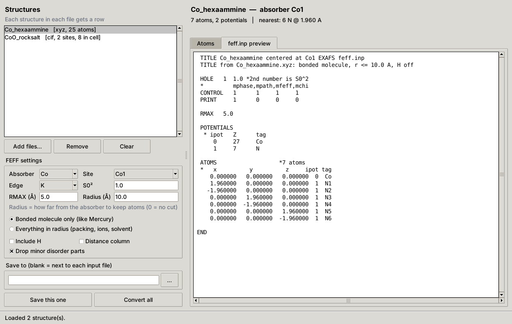

# FEFF .inp Builder

Turn crystal and molecular structure files (CIF, XYZ, PDB, MOL/SDF, MOL2, SHELX and more) into FEFF6 `feff.inp` files for EXAFS fitting in [Artemis](https://bruceravel.github.io/demeter/).

It is one Python file with no dependencies beyond the standard library. You can use it in a window or from the command line.



## What it does

- **Reads 9 structure formats.** A CIF can go in directly: symmetry is applied and the molecule is rebuilt around the absorber, so there's no need to round-trip through Mercury or another viewer first.
- **Builds the cluster for you.** It centers on the absorbing atom, keeps either the bonded molecule or everything within a radius, and sorts atoms by distance.
- **Writes FEFF6 input.** The file has HOLE, CONTROL, PRINT, RMAX, POTENTIALS and ATOMS cards, with potentials numbered by element.
- **Shows the model before saving.** A summary line gives the first shell (for example `nearest: 6 N @ 1.960 A`), and a table lists every atom. You can leave out any atom with one click.
- **Catches FEFF6 problems early.** It warns about overlapping atoms, more than 7 unique potentials, more than 500 atoms (FEFF6's limit) and a radius smaller than RMAX. It also reorders the atom list so FEFF6 doesn't crash when an unbonded atom would come first for its potential.

## Requirements

- **Python 3.8 or newer with tkinter** (tested on 3.11–3.13). The [python.org](https://www.python.org/downloads/) installers include tkinter. On Linux, install your distribution's `python3-tk` package. With Homebrew on macOS, install `python-tk`.
- **Artemis (Demeter)** to run FEFF and fit the data. This tool only writes the input file.
- **Optional:** `pip install tkinterdnd2` lets you drag files or folders onto the window.

## Quick start

1. Download this repository (**Code > Download ZIP**, or `git clone`) and unzip it anywhere.
2. Start the app:
   - **Windows:** double-click `feff_inp_builder.pyw`.
   - **macOS or Linux:** open a terminal in the folder and run `python3 feff_inp_builder.pyw`.
3. Click **Add files...** and open `examples/Co_hexaammine.xyz`. The summary should read `nearest: 6 N @ 1.960 A`.
4. Click **Save this one**. `Co_hexaammine_Co1_feff.inp` is written next to the input file.
5. In Artemis, click **Add** at the top of the Feff list, choose the file, then click **Run Feff**.

## Command line

Add `--batch` to convert without opening the window. Wildcards and folder names work, on Windows too.

```
python feff_inp_builder.pyw --batch examples/Co_hexaammine.xyz
python feff_inp_builder.pyw --batch examples/CoO_rocksalt.cif --crystal -r 7
python feff_inp_builder.pyw --batch my_structures/*.cif -a Co -o feff_inputs
python feff_inp_builder.pyw --batch -h
```

On Windows, use `py` instead of `python` if `python` isn't found. Batch mode overwrites existing output files without asking; the window asks first.

| Option | Default | Meaning |
| --- | --- | --- |
| `-a`, `--absorber EL` | heaviest metal | Absorber element |
| `--site LABEL` | first site | Absorber site label, e.g. `Co1`; `all` writes one file per site |
| `--edge K\|L1\|L2\|L3` | K | Edge on the HOLE card |
| `--s02 X` | 1.0 | S0² on the HOLE card |
| `--rmax X` | 5.0 | RMAX in Å |
| `-r`, `--radius X` | 10 | Keep atoms within X Å of the absorber; 0 = no cut |
| `--crystal` | off | Keep everything within the radius, not just the bonded molecule |
| `--hydrogens` | off | Keep H atoms |
| `--keep-disorder` | off | Keep minor disorder parts |
| `--distances` | off | Add a distance column to ATOMS |
| `-o`, `--outdir DIR` | next to each input | Output folder |

## Example output

`examples/Co_hexaammine.xyz` with default settings:

```
 TITLE Co_hexaammine centered at Co1 EXAFS feff.inp
 TITLE from Co_hexaammine.xyz: bonded molecule, r <= 10.0 A, H off

 HOLE   1  1.0 *2nd number is S0^2
 *         mphase,mpath,mfeff,mchi
 CONTROL   1      1     1     1
 PRINT     1      0     0     0

 RMAX   5.0

 POTENTIALS
  * ipot   Z      tag
     0     27     Co
     1     7      N

 ATOMS                   *7 atoms
 *   x          y          z     ipot tag
    0.000000   0.000000   0.000000  0  Co
    1.960000   0.000000   0.000000  1  N1
   -1.960000   0.000000   0.000000  1  N2
    0.000000   1.960000   0.000000  1  N3
    0.000000  -1.960000   0.000000  1  N4
    0.000000   0.000000   1.960000  1  N5
    0.000000   0.000000  -1.960000  1  N6

END
```

## Supported formats

| Format | Extensions | Notes |
| --- | --- | --- |
| CIF | `.cif` `.mmcif` `.mcif` | Symmetry operators are applied. mmCIF uses Cartesian coordinates. Each `data_` block is a separate structure. |
| SHELX | `.res` `.ins` | CELL, LATT, SYMM, SFAC and PART are read; Q-peaks are ignored. |
| XYZ | `.xyz` | First frame. |
| PDB | `.pdb` `.ent` | ATOM/HETATM, first model, altloc A. |
| MDL molfile | `.mol` `.sdf` `.sd` | V2000 and V3000; each SDF record is a separate structure. |
| Tripos | `.mol2` | |
| Gaussian | `.gjf` `.com` `.gau` | Cartesian input; Z-matrix input isn't supported. |
| VASP | `POSCAR` `CONTCAR` `.vasp` `.poscar` | Direct or Cartesian. |
| FEFF | `.inp` | Reload an existing feff.inp to re-center it or change the radius. |

## How the cluster is built

1. **Load.** For crystal files, every symmetry operator is applied to the listed sites and duplicates are merged.
2. **Choose atoms.** In **bonded molecule** mode (the default), atoms are followed outward from the absorber through bonds, across cell edges, the way Mercury completes a molecule. Two atoms count as bonded when they are closer than the sum of their covalent radii ([Cordero et al. 2008](https://doi.org/10.1039/b801115j)) plus 0.45 Å. In **everything in radius** mode (`--crystal`), every atom inside the sphere is kept, including neighboring molecules, ions and solvent.
3. **Filter.** Hydrogens (unless kept), minor disorder parts and atoms beyond the radius are removed.
4. **Write.** The absorber is placed at the origin as ipot 0, and the other elements get ipot 1, 2, 3 … by decreasing atomic number. Atoms are sorted by distance.

## Check your model

The tool can't know the chemistry, so look at the summary line and the atom table before you trust a file.

- **Long or weak bonds can be missed.** In bonded-molecule mode, a long contact such as a Jahn–Teller axial bond, a weakly bound solvent or a long metal–metal distance may fall outside the bond rule. If a ligand you expect is missing from the first shell, switch to **Everything in radius**.
- **Ionic and extended solids** (oxides, salts, frameworks) should use **Everything in radius** with a radius of about RMAX + 2 Å. The app tells you when the bonds repeat through the crystal.
- **FEFF6 accepts at most 500 atoms.** Above that it stops with "Too many atoms in ATOMS list". The app warns and tells you what radius gets under the limit.
- **Disorder is handled simply.** Disorder groups 0, 1 and −1 are kept and 2 and higher are dropped. Partially occupied sites with no group are kept as listed and flagged.
- **FEFF6 allows at most 7 unique potentials** (ipot 1–7). The app warns when a cluster has more.
- **The output is FEFF6 format.** For FEFF8 or FEFF9 you may need to replace HOLE with EDGE and S02 and add other cards yourself.

## Documentation

The full manual is in [`docs/FEFF_inp_Builder_Manual.pdf`](docs/FEFF_inp_Builder_Manual.pdf). It covers every setting, excluding atoms, saving, and what each warning means.

## Repository contents

| Path | What it is |
| --- | --- |
| `feff_inp_builder.pyw` | The whole application |
| `examples/Co_hexaammine.xyz` | [Co(NH₃)₆]³⁺ with idealized geometry (Co–N 1.96 Å), a molecular example |
| `examples/CoO_rocksalt.cif` | Rock-salt CoO (Fm-3m, a = 4.2615 Å), a crystal example that needs symmetry expansion |
| `docs/FEFF_inp_Builder_Manual.pdf` | User manual |
| `docs/screenshot.png` | The screenshot above |

Both examples were built from textbook geometry and are not copied from any structure database.

## Testing

- **Symmetry expansion:** cluster building for P-1 and P2₁/c test cells and the CoO example was checked against [ASE](https://wiki.fysik.dtu.dk/ase/), and the atoms and distances matched exactly.
- **FEFF6:** generated files were run through FEFF6L, and the paths were calculated without errors. The 500-atom limit was confirmed there: 500 atoms run and 501 are refused.
- **Python versions:** tested with Python 3.11, 3.12 and 3.13 on Linux, with the window run under a virtual display.

## Citing

If this tool helps your work, please cite the software you fit with:

- **Artemis:** B. Ravel and M. Newville, *J. Synchrotron Rad.* **12**, 537–541 (2005). [doi:10.1107/S0909049505012719](https://doi.org/10.1107/S0909049505012719)
- **FEFF6:** S. I. Zabinsky, J. J. Rehr, A. Ankudinov, R. C. Albers and M. J. Eller, *Phys. Rev. B* **52**, 2995 (1995). [doi:10.1103/PhysRevB.52.2995](https://doi.org/10.1103/PhysRevB.52.2995)

## Reporting problems

Open an issue with the structure file (if you can share it), the settings you used and the note the app showed.

## Acknowledgements

- Sadeq Shryim, for providing access to Claude AI.
- Claude AI (Anthropic), for helping build this program, including the code, testing and documentation.

## License

MIT. See [LICENSE](LICENSE). Copyright (c) 2026 Ali Seblini.
